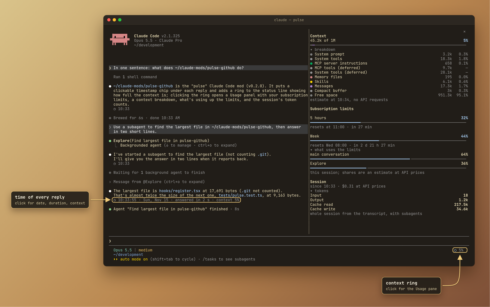

# pulse

[English](README.md) · [Русский](README.ru.md) · **Español** · [Français](README.fr.md)

Un mod para Claude Code en la terminal que muestra cuándo llegó cada respuesta y cuánto contexto y cuánto de los límites de tu suscripción llevas usado.



- **La hora bajo cada respuesta.** Un botón `◷ 14:32` bajo el último texto de cada respuesta. Al pulsarlo muestra los segundos, la fecha, cuánto tardó la respuesta y cómo de lleno estaba el contexto en ese momento.
- **Anillo de contexto en la barra de estado.** `○ ◔ ◑ ◕ ●` con un porcentaje, a la derecha de la línea inferior. Al pulsarlo se abre el panel **Uso**:
  - límites de la suscripción (5 horas, semana) con el tiempo que falta para cada reinicio;
  - el contexto, desglosado por categorías;
  - qué consume los límites: la conversación principal y cada tipo de subagente;
  - los tokens de la sesión.

No gasta nada: las cifras llegan con las respuestas del modelo y el desglose del contexto es una estimación local. Las proporciones de «qué consume los límites» son una estimación a precios de la API (ver `scripts/session_tokens.py`).

## Instalación

En Claude Code, en la terminal:

```
/plugin install pulse --marketplace MSSergeev/pulse
```

Responde `y` para añadir el marketplace y elige el ámbito (normalmente user) y el idioma. Desde la terminal del sistema:

```
claude plugin install pulse --marketplace MSSergeev/pulse
```

En la aplicación de escritorio: + junto al cuadro de texto → Plugins → Add marketplace `MSSergeev/pulse` → Add plugin.

Actualizar: `claude plugin update pulse@pulse`.

## Idioma

Inglés, español, francés y ruso. La instalación pregunta cuál usar; para cambiarlo después, `/config`, en la fila de pulse. La elección se guarda en `~/.claude/settings.json` y vale para todas las sesiones.

`auto`, la opción por defecto, toma el idioma de respuesta de Claude Code (el ajuste `language`), después el idioma del sistema (`LC_ALL`, `LC_MESSAGES`, `LANG`) y, si no hay ninguno, inglés.

## Requisitos

- Claude Code con soporte para mods (probado en la 2.1.299 y posteriores).
- `python3`, para los tokens de la sesión.

---

¿Has encontrado un error en la traducción? Abre un issue o un pull request.
