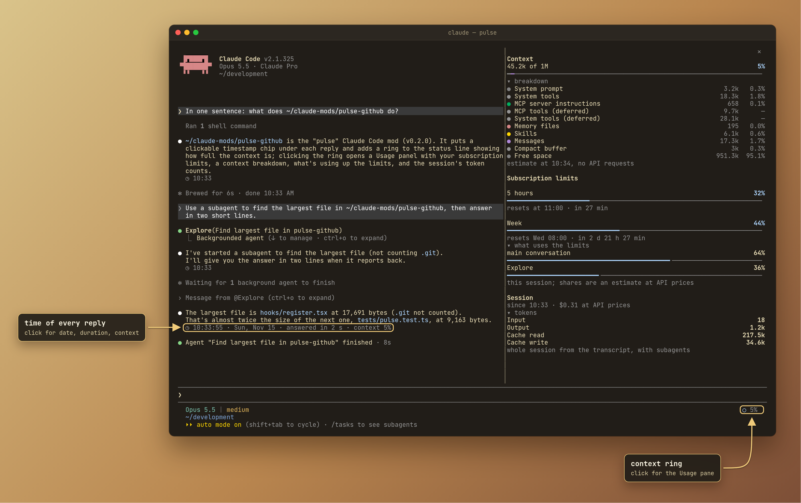

# pulse

**English** · [Русский](README.ru.md) · [Español](README.es.md) · [Français](README.fr.md)

A mod for Claude Code in the terminal that shows when each reply came and how much of your context and subscription limits is used.



- **Time under every reply.** A `◷ 14:32` chip under the last text of each reply. Click it for the seconds, the date, how long the reply took and how full the context was at that moment.
- **Context ring in the status line.** `○ ◔ ◑ ◕ ●` with a percentage, on the right of the bottom line. Click it to open the **Usage** pane:
  - subscription limits (5 hours, week) with the time left until each resets;
  - context, with a breakdown by category;
  - what uses the limits: the main conversation and each kind of subagent;
  - the session's tokens.

It costs nothing: the numbers arrive with the model's replies, and the context breakdown is a local estimate. The shares in "what uses the limits" are an estimate at API prices (see `scripts/session_tokens.py`).

## Install

At the prompt of Claude Code in a terminal:

```
/plugin install pulse --marketplace MSSergeev/pulse
```

Answer `y` to add the marketplace, pick a scope (user is the usual one) and the language. From a shell:

```
claude plugin install pulse --marketplace MSSergeev/pulse
```

In the desktop app: + next to the prompt box → Plugins → Add marketplace `MSSergeev/pulse` → Add plugin.

Update: `claude plugin update pulse@pulse`.

## Language

English, Spanish, French and Russian. The install asks for one; change it later in `/config`, in the pulse row. The choice is saved in `~/.claude/settings.json` and applies to every session.

`auto`, the default, takes Claude Code's own response language (the `language` setting), then the system language (`LC_ALL`, `LC_MESSAGES`, `LANG`), and falls back to English.

## Requirements

- Claude Code with mod support (checked on 2.1.299 and later).
- `python3`, for the session's tokens.
