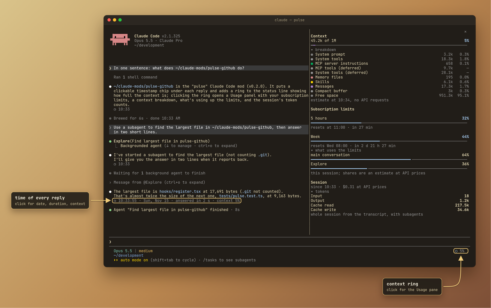

# pulse

[English](README.md) · **Русский** · [Español](README.es.md) · [Français](README.fr.md)

Мод для Claude Code в терминале: показывает, когда пришёл каждый ответ и сколько израсходовано контекста и лимитов подписки.



- **Время под каждым ответом.** Под последним текстом ответа — кнопка `◷ 14:32`. Клик раскрывает секунды, дату, сколько длился ответ и заполненность контекста на тот момент.
- **Колечко контекста в нижней строке.** `○ ◔ ◑ ◕ ●` с процентом справа. Клик открывает панель **Расход**:
  - лимиты подписки (5 часов, неделя) со временем до сброса;
  - контекст с разбивкой по категориям;
  - что расходует лимиты: основной диалог и каждый тип субагентов;
  - токены сессии.

Ничего не тратит: цифры приходят с ответами модели, разбивка контекста — локальная оценка. Доли «что расходует лимиты» — оценка по ценам API (см. `scripts/session_tokens.py`).

## Установка

В Claude Code в терминале:

```
/plugin install pulse --marketplace MSSergeev/pulse
```

Ответьте `y`, чтобы добавить маркетплейс, выберите область (обычно user) и язык. Из оболочки:

```
claude plugin install pulse --marketplace MSSergeev/pulse
```

В приложении для компьютера: + рядом с полем ввода → Plugins → Add marketplace `MSSergeev/pulse` → Add plugin.

Обновление: `claude plugin update pulse@pulse`.

## Язык

Английский, испанский, французский и русский. При установке мод спросит язык; поменять потом — в `/config`, в строке pulse. Выбор сохраняется в `~/.claude/settings.json` и действует во всех сессиях.

`auto` (по умолчанию) берёт язык ответов Claude Code (настройка `language`), затем язык системы (`LC_ALL`, `LC_MESSAGES`, `LANG`), иначе английский.

## Что нужно

- Claude Code с поддержкой модов (проверено на 2.1.299 и новее).
- `python3` — для токенов сессии.
